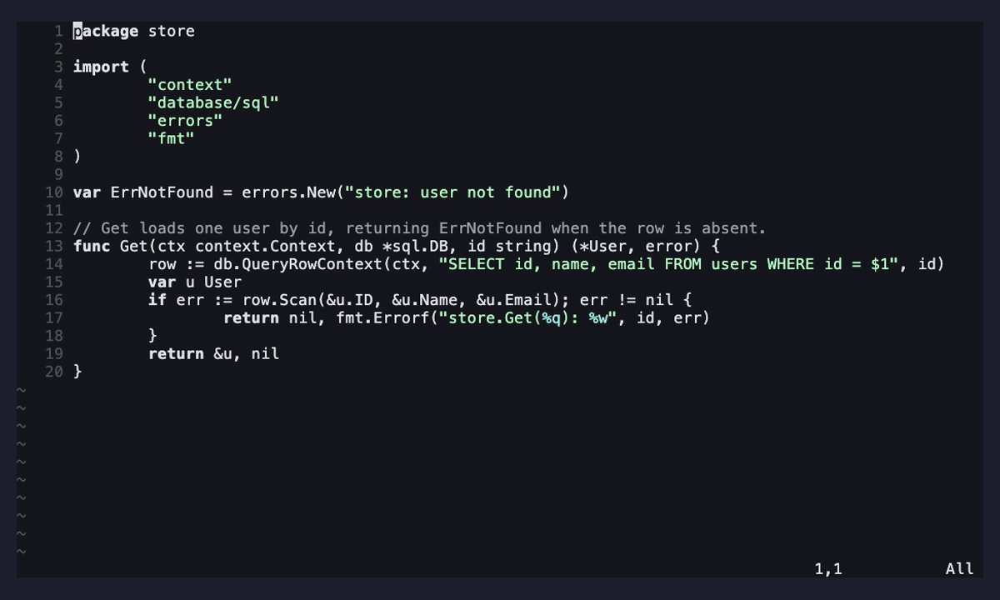

# ami-inline.nvim

Native, Copilot-style inline (FIM) completion for [ami](https://github.com/moosch/ami.nvim).

Ghost-text completion driven by a FIM code model, extracted from ami core into its
own extension. It talks **directly** to LM Studio's `/v1/completions` (not through
the daemon) to keep latency low, and preserves the advisor ethos: suggestions are
ghost text you explicitly accept or dismiss — nothing is written until you accept.

It registers a `fim` **model slot**, so `:AmiModel` lists it and you can point it at
any model LM Studio has loaded; if you don't, it inherits ami's default model.

## Demo

Comment-driven completion — write a comment, trigger (`<C-g>`), accept (`<Tab>`):



> Rendered from [`demos/inline.tape`](demos/inline.tape); see
> [`demos/README.md`](demos/README.md) to (re)generate it.

## Requirements

- [ami.nvim](https://github.com/moosch/ami.nvim) (provides the extension + model
  registry API).
- A FIM-capable code model loaded in LM Studio (Qwen Coder, DeepSeek-Coder,
  StarCoder2, CodeLlama).

## Install

With [lazy.nvim](https://github.com/folke/lazy.nvim), install it alongside ami and
register it:

```lua
{
  "moosch/ami.nvim",
  dependencies = { "moosch/ami-inline.nvim" },
  build = "make build",
  config = function()
    require("ami").setup({
      extensions = { require("ami-inline") },
      -- inline = { model = "deepseek-coder-6.7b-instruct" }, -- optional override
    })
  end,
}
```

## Use

- Insert mode: `<C-g>` requests a completion, `<Tab>` accepts (falls back to a real
  Tab when there's nothing to accept), `<C-]>` dismisses.
- `:AmiComplete` requests a completion; `:AmiInlineAuto` toggles debounced
  as-you-type suggestions.
- `:AmiModel fim` picks the completion model live.

**Comment-driven completion** works like the original Copilot: write a comment
describing what you want, put the cursor on the line below, and trigger — the
comment is part of the FIM prefix, and code after the cursor is the suffix, so the
model fills in context-aware.

## Configuration

Options live under `inline` in ami's `setup()` (your values win over the defaults):

| Key | Default | Meaning |
| --- | --- | --- |
| `enabled` | `true` | master switch |
| `endpoint` | `nil` | provider base URL; `nil` ⇒ ami's default `model.endpoint` |
| `model` | `nil` | FIM model; `nil` ⇒ ami's default `model.model` (pick via `:AmiModel fim`) |
| `prewarm` | `true` | fire one tiny request on setup so the first completion is fast |
| `auto` | `false` | debounced as-you-type suggestions |
| `debounce_ms` | `400` | auto-trigger debounce |
| `max_tokens` | `256` | max completion tokens (enough for a whole function) |
| `max_lines` | `0` | truncate to N lines (`0` = no cap) |
| `temperature` | `0.2` | sampling temperature |
| `context_before_lines` / `context_after_lines` | `120` / `60` | prefix/suffix context windows |
| `timeout_ms` | `20000` | request timeout |
| `fim` | Qwen tokens | `{ prefix, suffix, middle }` — set to match your model family |
| `stop` | Qwen stops | stop sequences |
| `keymaps` | `<C-g>`/`<Tab>`/`<C-]>` | `{ trigger, accept, dismiss }` insert-mode keys |

**Not appearing?** Make sure the model's endpoint points at your LM Studio. Turn on
`:AmiDebug`, press `<C-g>`, and check `:AmiLog` — it reports the exact cause
(connection refused, timeout, server error). The first completion is often a
timeout while LM Studio loads the model; it works once warm (or raise `timeout_ms`
/ use a smaller FIM model / keep `prewarm = true`).

## License

[MIT](LICENSE)
